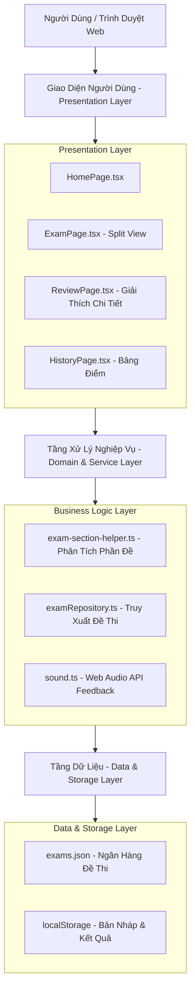

# 🎓 Testrix — Nền Tảng Luyện Thi Trắc Nghiệm Trực Tuyến

<div align="center">

[](https://tienganh-mrsngoc.vercel.app)
[](https://react.dev/)
[](https://vitejs.dev/)
[](https://www.typescriptlang.org/)
[](https://tailwindcss.com/)
[-10B981?style=for-the-badge)](https://tienganh-mrsngoc.vercel.app)

**Hệ thống Luyện thi & Ôn tập Tiếng Anh Trực tuyến Dành cho Học sinh THPT**  
*Biên soạn & Giảng dạy bởi **Mrs. Hồ Thị Bích Ngọc** — Giáo viên trường THPT Nguyễn Dục, Phú Ninh, Đà Nẵng*

[🌐 Trải Nghiệm Website](https://tienganh-mrsngoc.vercel.app) • [✨ Tính Năng Nổi Bật](#-tính-năng-nổi-bật) • [🏗️ Kiến Trúc Hệ Thống](#-kiến-trúc-hệ-thống) • [🚀 Hướng Dẫn Cài Đặt](#-hướng-dẫn-cài-đặt--phát-triển) • [📝 Quản Lý Đề Thi](#-hướng-dẫn-thêm--quản-lý-đề-thi-mới) • [📞 Liên Hệ](#-thông-tin-liên-hệ--giáo-viên-phụ-trách)

---

</div>

## 📌 Giới Thiệu Chung

**Testrix** là giải pháp phần mềm thi thử và ôn luyện trắc nghiệm trực tuyến thế hệ mới, được thiết kế chuyên sâu theo chuẩn cấu trúc đề thi tốt nghiệp THPT và kiểm tra định kỳ của Bộ Giáo dục & Đào tạo. 

Dự án hoạt động trên nền tảng web hiện đại với triết lý **Zero-Auth (Không cần tài khoản)**:
- Học sinh không cần đăng ký tài khoản hay ghi nhớ mật khẩu.
- Nhấp vào link là có thể làm bài ngay lập tức trên mọi thiết bị (máy tính, iPad, điện thoại).
- Tiến độ bài làm được tự động sao lưu theo thời gian thực (Auto-Save Local Draft).

> [!TIP]
> Website chính thức đang hoạt động tại: **[https://tienganh-mrsngoc.vercel.app](https://tienganh-mrsngoc.vercel.app)**.

---

## ✨ Tính Năng Nổi Bật

### 1. 📋 Phòng Thi Bố Cục 2 Cột Chuẩn Bộ GD&ĐT (Split-View Layout)
* **Phân chia chuyên đề tự động**: Đề thi được phân tách thành từng phần độc lập với tiêu đề rõ ràng:
  * `I. TRỌNG ÂM (STRESS)`
  * `II. TỪ VỰNG & NGỮ PHÁP (VOCABULARY AND GRAMMAR)`
  * `III. ĐỌC HIỂU & ĐỌC ĐIỀN TỪ (READING PASSAGES)`
  * `IV. VIẾT & SẮP XẾP CÂU (SENTENCE TRANSFORMATION)`
* **Huy hiệu dải câu thông minh**: Hiển thị chính xác khoảng câu hỏi (ví dụ: `Câu 1 - Câu 5 (5 câu)`, `Câu 6 - Câu 21 (16 câu)`).
* **Khung bài đọc cổ điển**: Đoạn văn đọc hiểu được đóng khung trang nhã, học sinh có thể vừa đọc bài văn vừa làm các câu hỏi trắc nghiệm liền kề mà không cần cuộn trang lên xuống liên tục.

### 2. 🎯 Phiếu Trả Lời Trắc Nghiệm Thông Minh (Smart Answer Sheet)
* **Tiến độ trực quan theo từng phần**: Đếm số câu đã hoàn thành theo thời gian thực (ví dụ: `5/5`, `12/16`).
* **Điều hướng tức thì (Smooth Navigation)**: Nhấp vào số câu trên phiếu để màn hình cuộn mượt đến đúng vị trí câu hỏi đó.
* **Cờ tím đánh dấu câu khó (🟣 Purple Flag)**: Đánh dấu các câu học sinh còn phân vân để dễ dàng quay lại rà soát trước khi nộp bài.
* **Bảng màu trạng thái chuẩn xác**:
  * 🟢 **Xanh lá**: Đã hoàn thành câu trả lời.
  * 🟣 **Tím**: Cần xem lại trước khi nộp bài.
  * ⚪ **Trắng/Xám**: Chưa chọn đáp án.

### 3. 💡 Chấm Điểm Thang 10 & Lời Giải Phân Tích Sư Phạm
* **Chấm điểm tức thì**: Hệ thống tính toán điểm số chuẩn xác ngay khi nhấn nộp bài.
* **Phân tích số liệu toàn diện**: Thống kê số câu đúng, câu sai, câu bỏ sót và tổng thời gian làm bài.
* **Hộp thoại giải thích chi tiết**: Cung cấp lý do chọn đáp án đúng, dịch nghĩa từ vựng, phân tích cấu trúc ngữ pháp và chỉ ra các bẫy thường gặp.
* **Bộ lọc kết quả tiện lợi**: Lọc nhanh danh sách câu theo `Tất cả` | `Câu đúng` | `Câu sai` | `Chưa làm`.

### 4. 🔒 Bảo Mật & Lưu Trữ Cục Bộ (Zero-Auth Privacy)
* **Tự động lưu nháp**: Không lo mất dữ liệu bài làm khi gặp sự cố mạng, vô tình tắt tab hoặc tải lại trang.
* **Trang Lịch Sử Cá Nhân**: Lưu toàn bộ lịch sử các lần thi trước trên trình duyệt máy tính cá nhân để học sinh tự theo dõi sự tiến bộ.
* **Làm lại bài thi**: Cho phép luyện tập lại nhiều lần để khắc sâu kiến thức.

### 5. 📱 Tối Ưu Hóa Công Thái Học & Đa Nền Tảng (Responsive)
* **Desktop & Laptop**: Giao diện 2 cột chia đôi màn hình khoa học, phiếu trả lời ghim cố định bên phải.
* **Mobile & Tablet**: Phiếu trả lời dạng Bottom Drawer vuốt mở linh hoạt, nút nộp bài luôn nằm trong tầm tay.

---

## 🏗️ Kiến Trúc Hệ Thống (Clean Architecture)

Dự án áp dụng mô hình phân lớp rõ ràng nhằm đảm bảo hiệu năng cao và dễ dàng mở rộng:



---

## 🛠️ Công Nghệ Phát Triển (Tech Stack)

| Thành phần | Công nghệ | Phiên bản | Vai trò & Ưu điểm |
| :--- | :--- | :--- | :--- |
| **Giao diện** | [React](https://react.dev/) | 19.3.0 | UI Component thế hệ mới nhất, rendering siêu tốc |
| **Biên dịch** | [Vite](https://vitejs.dev/) | 8.0 | HMR tức thì, Production build chỉ mất ~350ms |
| **Ngôn ngữ** | [TypeScript](https://www.typescriptlang.org/) | 5.0 | Type Safety nghiêm ngặt, loại bỏ hoàn toàn lỗi runtime |
| **Định tuyến** | [React Router](https://reactrouter.com/) | 7.18 | Single Page Application mượt mà, hỗ trợ deep-linking |
| **Styling** | [TailwindCSS](https://tailwindcss.com/) | v4.0 | Utility CSS tinh gọn, bundle CSS tối ưu chỉ ~51 kB |
| **Biểu tượng** | [Lucide React](https://lucide.dev/) | 1.59 | Bộ icon hiện đại, tải bất đồng bộ theo trang |
| **Lưu trữ** | HTML5 `localStorage` | Chuẩn W3C | Lưu trữ dữ liệu client-side nhanh chóng, không tốn chi phí DB |
| **Triển khai** | [Vercel](https://vercel.com/) | Cloud CDN | Tự động CI/CD từ GitHub, hạ tầng phân tán toàn cầu |

---

## 📂 Cấu Trúc Thư Mục Dự Án

```bash
Testrix/
├── public/                      # Static assets, Favicon, _redirects, robots.txt
├── src/
│   ├── components/
│   │   ├── common/              # Navbar, Footer, GradeTabs dùng chung toàn app
│   │   └── exam/                # AnswerSheet, ExamHeader, ExamQuestionItem,
│   │                            # ExamSectionView, ResultModal, SubmitConfirmModal
│   ├── data/
│   │   ├── examRepository.ts    # Service xử lý & lọc ngân hàng đề thi
│   │   └── exams.json           # Tệp JSON chứa toàn bộ câu hỏi và đáp án
│   ├── lib/
│   │   ├── exam-section-helper.ts # Bộ giải mã và nhóm phần thi tự động
│   │   ├── local-storage.ts     # Tầng quản lý lưu nháp & lịch sử điểm số
│   │   └── sound.ts             # Âm thanh hiệu ứng Web Audio API
│   ├── pages/
│   │   ├── HomePage.tsx         # Trang chủ giới thiệu & danh sách đề thi
│   │   ├── ExamPage.tsx         # Phòng thi trực tuyến 2 cột chuẩn Bộ GD
│   │   ├── ReviewPage.tsx       # Trang xem lại chi tiết lời giải & đáp án
│   │   └── HistoryPage.tsx      # Lịch sử và bảng thống kê kết quả làm bài
│   ├── types/
│   │   └── exam.ts              # Định nghĩa Typescript toàn diện cho đề thi
│   ├── App.tsx                  # Khởi tạo định tuyến React Router
│   ├── main.tsx                 # Điểm khởi động ứng dụng React
│   └── index.css                # CSS Variables & Tailwind Tokens
├── scripts/
│   ├── generate_sample_exam.js  # Kịch bản trích xuất đề Word sang exams.json
│   └── lib/                     # Thư viện phân tích định dạng file .docx
├── Exam/                        # Thư mục lưu trữ file đề thi gốc (Word .docx)
├── index.html                   # HTML Entry Point & thẻ Meta SEO
├── vercel.json                  # Cấu hình Vercel rewrite cho Single Page Application
├── vite.config.ts               # Cấu hình Vite & Path Aliases (@/*)
├── tsconfig.json                # Cấu hình TypeScript Strict Mode
└── package.json                 # Khai báo dependencies & scripts
```

---

## 🚀 Hướng Dẫn Cài Đặt & Phát Triển

### 1. Chuẩn bị môi trường
- Cài đặt **Node.js** (Khuyến nghị bản LTS 20 trở lên).
- Trình quản lý gói `npm` (mặc định đi kèm Node.js).

### 2. Cài đặt các thư viện
```bash
# Clone dự án về máy
git clone https://github.com/Khoa-NKD/Testrix.git

# Di chuyển vào thư mục dự án
cd Testrix

# Cài đặt toàn bộ dependencies
npm install
```

### 3. Khởi chạy máy chủ phát triển (Dev Server)
```bash
npm run dev
```
Mở trình duyệt truy cập: **`http://localhost:3000`**

### 4. Đóng gói kiểm tra sản phẩm (Production Build)
```bash
npm run build
```
Xem trước bản build cục bộ:
```bash
npm run preview
```

---

## ☁️ Hướng Dẫn Triển Khai Lên Vercel

Hệ thống được tối ưu hóa để tự động triển khai (CI/CD) mỗi khi có commit mới vào nhánh `main`:

1. Truy cập [Vercel Dashboard](https://vercel.com/) ➔ Chọn **Add New... ➔ Project**.
2. Chọn repository **`Khoa-NKD/Testrix`** ➔ Nhấn **Import**.
3. **Cài đặt triển khai**:
   - **Framework Preset**: Chọn **Vite**.
   - **Build and Output Settings**: Giữ nguyên trạng thái mặc định (TẮT tất cả nút gạt).
4. Nhấn **Deploy**. Sau ~30 giây, website sẽ được xuất bản thành công!
5. **Cài đặt Domain thương hiệu**:
   - Vào mục **Settings ➔ Domains**.
   - Thêm tên miền: `tienganh-mrsngoc.vercel.app`.
   - Vercel tự động cấp chứng chỉ HTTPS an toàn tuyệt đối.

---

## 📝 Hướng Dẫn Thêm & Quản Lý Đề Thi Mới

Khi cô Ngọc muốn thêm đề thi mới cho học sinh luyện tập:

### Cách 1: Thêm trực tiếp vào `src/data/exams.json` (Nhanh nhất)
Mỗi đề thi là một phần tử trong mảng `exams`. Bạn chỉ cần thêm đối tượng mới theo cấu trúc chuẩn:
```json
{
  "id": "de-on-tap-tieng-anh-12-gk2",
  "title": "Đề Ôn tập Giữa học kỳ 2 - Môn Tiếng Anh 12",
  "description": "Đề thi chuẩn cấu trúc Bộ GD&ĐT gồm 50 câu trắc nghiệm...",
  "subject": "Tiếng Anh",
  "grade": "Lớp 12",
  "durationMinutes": 50,
  "totalQuestions": 50,
  "sections": [
    {
      "id": "sec-1",
      "title": "I. TRỌNG ÂM (STRESS)",
      "instruction": "Mark the letter A, B, C or D to indicate...",
      "questionIndices": [1, 2, 3, 4, 5]
    }
  ],
  "questions": [
    {
      "index": 1,
      "text": "Mark the letter A, B, C or D to indicate the word whose stress differs...",
      "options": ["A. economic", "B. historic", "C. electronic", "D. scientific"],
      "correctAnswer": "B",
      "explanation": "historic trọng âm rơi vào âm tiết thứ 2, các từ còn lại rơi vào âm tiết thứ 3."
    }
  ]
}
```

### Cách 2: Tự động trích xuất từ file Word (.docx)
1. Đặt file Word đề thi vào thư mục [`Exam/`](file:///d:/Testrix/Exam/).
2. Chạy kịch bản phân tích:
   ```bash
   node scripts/generate_sample_exam.js
   ```
3. Đẩy lên GitHub:
   ```bash
   git add .
   git commit -m "feat: thêm đề thi mới cho học sinh khối 12"
   git push origin main
   ```
   *Vercel sẽ tự động build và cập nhật đề mới lên trang web trong vòng 1 phút!*

---

## 📞 Thông Tin Liên Hệ & Giáo Viên Phụ Trách

Mọi thắc mắc về nội dung bài giảng, tài liệu ôn thi hoặc đăng ký các khóa học Tiếng Anh xin vui lòng liên hệ:

* **Giáo viên phụ trách:** **Mrs. Hồ Thị Bích Ngọc**
* **Đơn vị công tác:** Giáo viên trường THPT Nguyễn Dục, Phú Ninh, Đà Nẵng
* **Địa chỉ lớp học:** 54 Điện Biên Phủ, TP. Tam Kỳ, Tỉnh Quảng Nam
* **Hotline / Zalo:** [0984 562 696](tel:0984562696)
* **Website học tập:** [https://tienganh-mrsngoc.vercel.app](https://tienganh-mrsngoc.vercel.app)

---

<div align="center">

**© 2026 Testrix.vn — Bản quyền thuộc về Lớp Tiếng Anh Mrs. Ngọc.**  
*Được phát triển với tâm huyết vì sự tiến bộ của các thế hệ học sinh Việt Nam.*

</div>

